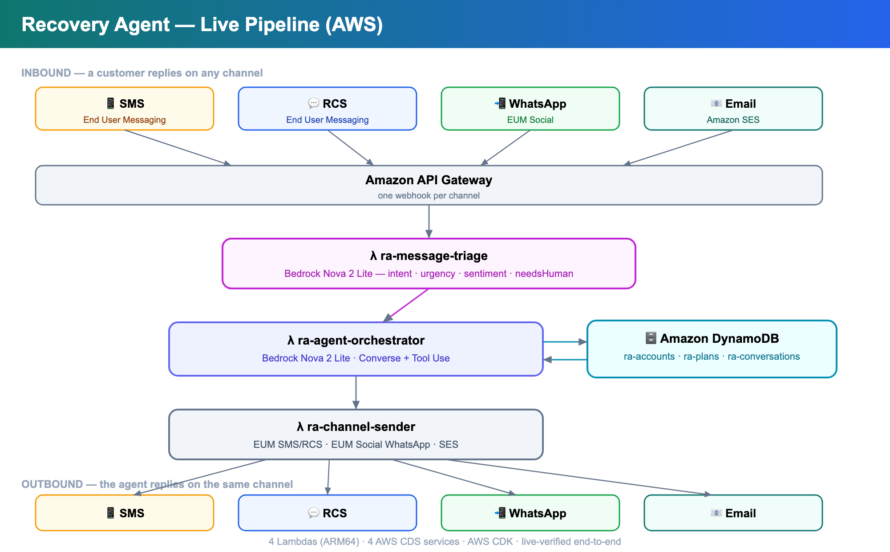
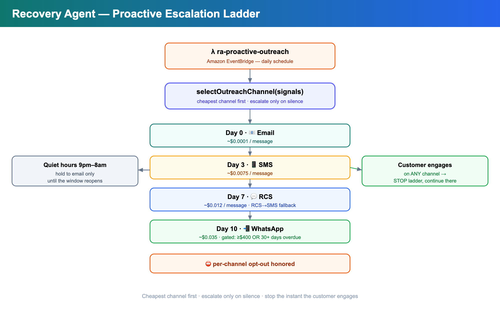
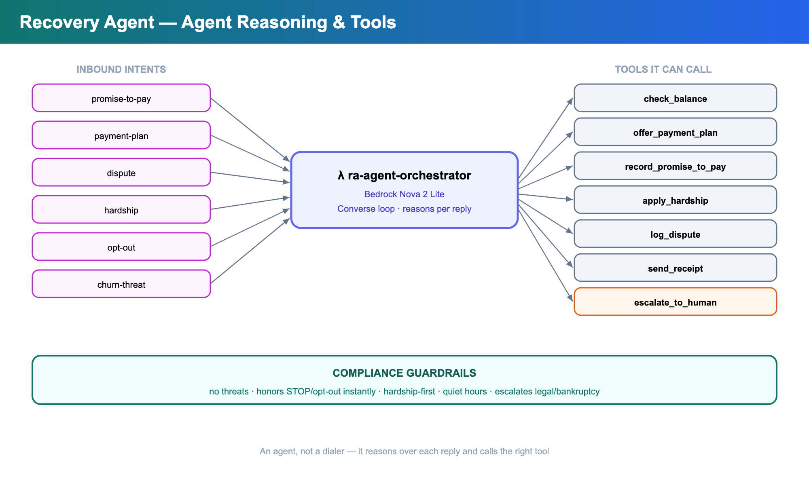
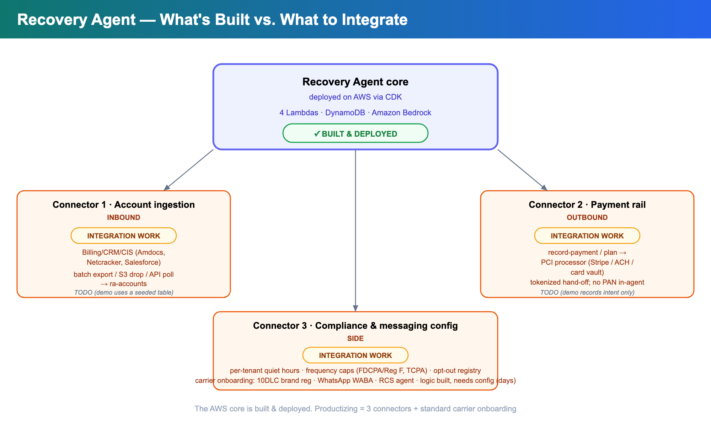

# Recovery Agent

**Your channels deliver messages. Recovery Agent decides what happens next.**

Recovery Agent is a telecom past-due recovery prototype. It selects a next action using account context, channel availability and conversation history, then applies deterministic policy before any AWS messaging call. Amazon Bedrock can recommend actions and invoke account tools; it cannot authorize access or override opt-out, hardship, dispute, quiet-hour or contact-limit restrictions.

This work hardens the existing Lambda/TypeScript/CDK implementation. It has been deployed to a controlled AWS demo account (vf-dev-team5, us-east-1) and one decision was traced live end to end: an Amazon Bedrock–eligible recommendation, deterministic policy authorization, and a **real Amazon SES provider acceptance** with a provider message ID, all under a single correlation ID (see the observed trace in [HARDENING.md](docs/HARDENING.md)). That trace proves provider *acceptance*, not downstream delivery, and covers the email channel only; SMS/RCS/WhatsApp remain sandbox/onboarding-gated. Bundled screenshots, recordings and historical captures are demonstrations, not verification.

## Architecture and trust boundaries

Four diagrams describe the system. Source SVGs: [Runtime](docs/architecture-runtime.svg) · [Decision flow](docs/architecture-decision-flow.svg) · [Agent tools](docs/architecture-agent-tools.svg) · [External integrations](docs/architecture-integration.svg).

**Runtime pipeline** — inbound channels → API Gateway → triage (Nova 2 Lite) → orchestrator (Converse + Tool Use) ⇄ DynamoDB → channel sender → outbound.



**Escalation-ladder decision flow** — daily proactive outreach climbs email → SMS → RCS → WhatsApp by cost and silence, gated by quiet hours and per-channel opt-out; any customer reply stops the ladder.



**The agent (reasoning + tool belt)** — Nova triage classifies the inbound intent; the orchestrator calls the right tool from a fixed belt under compliance-by-design rules.



**Enterprise integration** — the deployed AWS core plus the three connectors (account ingestion, payment rail, compliance/messaging config) that remain production integration work.



```text
Authenticated channel adapter -> triage (Bedrock Nova 2 Lite)
 -> orchestrator + verified canonical identity -> owned account tools
 -> Bedrock recommendation -> deterministic policy authorization
 -> async queue acceptance -> final sender policy gate
 -> AWS CDS provider acceptance -> authenticated delivery event, if configured
                         \-> correlated DynamoDB audit
```

The diagrams describe the core topology; this revision additionally isolates OTP transport and adds a hashed-session store. API Gateway POST endpoints now require IAM authorization. A carrier webhook must pass through a signature-validating, authenticated adapter; accepting arbitrary public JSON as a verified customer is unsafe. Such provider adapters/onboarding are not automatically configured here.

## AWS services and execution status

| Service | SDK v3 package | Runtime operation and purpose | Evidence for this revision |
|---|---|---|---|
| Amazon Bedrock | `client-bedrock-runtime` | `ConverseCommand`: inbound triage, planning, agent tool loop; default `us.amazon.nova-2-lite-v1:0` | Implemented; mocked handler tests; **live-exercised on vf-dev-team5** in the observed outreach trace (recommendation → policy authorization) |
| AWS Lambda | `client-lambda` | `InvokeCommand`: async orchestration/collection sends; synchronous OTP provider result | Implemented and synthesized offline |
| DynamoDB | `client-dynamodb`, `lib-dynamodb` | Get/Query/Put/Update/Delete/TransactWrite: accounts, identity, single-use sessions, audit, plans/escalations | Implemented; AWS clients mocked in tests |
| EUM SMS | `client-pinpoint-sms-voice-v2` | `SendTextMessageCommand` | Implemented; requires origination setup, regional availability and sandbox/production permissions |
| EUM RCS | same | `SendRcsMessageCommand`; configured agent, SMS fallback when agent unavailable | Implemented; requires agent approval/testing devices; live delivery not asserted |
| EUM Social / WhatsApp | `client-socialmessaging` | `SendWhatsAppMessageCommand` | Implemented; requires WABA/phone onboarding and applicable messaging permissions |
| Amazon SES | `client-sesv2` | `SendEmailCommand`: messages, OTP, optional internal escalation notification | Implemented; **live-verified on vf-dev-team5** — a real send returned a provider message ID recorded as `provider_accepted` (OTP + collection email); sandbox requires verified sender/recipients; downstream delivery not asserted |
| API Gateway / EventBridge | CDK constructs | IAM ingress and daily outreach scheduling | Synthesized; schedule becomes active on deployment |

Provider API acceptance is not delivery. The guided demo simulates the customer journey and channel outcomes. Historical fixtures are labeled separately. There is no payment gateway integration. Nothing in local CI sends messages or incurs AWS messaging/model charges.

## Getting started

Use Node.js 22 and npm with the committed lockfile:

```sh
npm ci
npm run build
npm test -- --runInBand --coverage
CDK_DEFAULT_ACCOUNT=111111111111 CDK_DEFAULT_REGION=us-east-1 npm run synth -- --all --quiet
npm run demo:local
python3 -m http.server 8080 --directory demo/web
```

Static interfaces: `http://localhost:8080/` (illustrative journey), `/architecture.html`, `/dashboard.html`. The dashboard can load an audit JSON export with `?src=YOUR_RELATIVE_JSON_PATH`. Serve only privacy-reviewed exports. The offline demo uses local fixtures and heuristic behavior; it is not AWS execution evidence. See [deployment and invocation contracts](docs/HARDENING.md) before live use.

To deploy deliberately into a controlled AWS demo environment:

```sh
export AWS_PROFILE=YOUR_DEMO_PROFILE
export CDK_DEFAULT_ACCOUNT=YOUR_ACCOUNT_ID CDK_DEFAULT_REGION=us-east-1
export SES_FROM_EMAIL=YOUR_VERIFIED_SENDER
# Optional configured origination identities and internal support destination:
# EUM_PHONE_POOL_ID, RCS_AGENT_ID, WHATSAPP_PHONE_NUMBER_ID, SUPPORT_INBOX
# Bind EUM_ORIGINATION_ARNS (comma-separated) and WHATSAPP_ORIGINATION_ARN
# to permitted demo provider resources before production deployment.
npm run synth -- --all --quiet
npm run deploy
```

The deploying principal needs CDK bootstrap/deployment permissions (CloudFormation, asset bucket and role passing). Runtime roles are generated by CDK. Messaging prerequisites and Bedrock model/profile authorization must be configured separately; a fresh AWS account cannot send across every channel immediately. `SUPPORT_INBOX` is synthesized into configuration only when set; no model-provided support destination is accepted.

## Reproducible live proof (operator-run)

One end-to-end decision has been observed live on vf-dev-team5 (recommendation → policy authorization → real SES `provider_accepted` + message ID, correlated in the audit log) — see the observed trace in [HARDENING.md](docs/HARDENING.md). The steps below are the reproducible operator path to repeat it in a controlled environment.

1. Deploy, ingest a controlled test account with a trusted `customerId`, and complete enrollment/OTP as described in [HARDENING.md](docs/HARDENING.md).
2. Put a normalized inbound message from that verified test address in a local protected JSON file. Include unique `messageId`, `channel`, `from`, `to`, `timestamp`, and `text`; do not commit the file.
3. Invoke the authenticated test workflow and export evidence:

```sh
PROOF_MESSAGE_FILE=/absolute/path/test-message.json AWS_PROFILE=YOUR_DEMO_PROFILE bash demo/live/live-proof.sh
aws dynamodb scan --table-name ra-decision-log --output json \
  | node demo/tools/declog-to-json.js > /tmp/decisions.json
# Serve a privacy-reviewed copy alongside dashboard.html, then use ?src=decisions.json
```

That invokes real triage, then the orchestrator asynchronously. Inspect the response, account mutations, and correlated audit entries. For eligible proactive contact, invoke `ra-proactive-outreach` with `{}` through an authorized operator role. Its result `queued` only proves Lambda accepted the event. The sender records its own `provider_accepted` and provider message IDs, or `policy_blocked`/`failed`. Delivery is recorded only after a trusted provider callback identifies an accepted message. No delivery subscriptions are deployed by default. Hardship or opt-out may correctly prevent any messaging call; do not reset protections to obtain a preferred result.

Existing `phase1-proof.sh` no longer deploys, clears opt-outs or sends to hardcoded destinations. Do not treat the presence of any script as proof it ran successfully.

## Security and policy

- Canonical identity links are verified explicitly; names and model-supplied IDs never establish ownership.
- Session capabilities contain 256 random bits. Only SHA-256 hashes are stored, bound to customer, method and a 15-minute lifetime. DynamoDB conditional deletes consume them once, including under replay races.
- An existing verified channel can be reverified by a fresh OTP sent only to that channel. Initial enrollment requires an authenticated operator-bound account flow; arbitrary new `customerId` claims are rejected. OTP expires in ten minutes, with five attempts and atomic consumption.
- Every production account tool requires verified conversation context and canonical account ownership. Payment-plan acceptance checks plan/account/recipient and uses a transaction. Account mutations condition on owner. Foreign recipient requests are denied; receipts resolve a verified email link.
- The collection sender requires `purpose: collection`, validated payloads, a verified destination, and a resolvable matching account. `bypassPolicy` grants no exemption. OTP has a separate IAM entry point and single-use delivery capability; its body comes from a stored challenge and fixed template, never caller prose.
- Opt-out is persisted deterministically before confirmation; hardship/dispute/restricted accounts suppress collection. Quiet hours, minimum contact interval and caps are reevaluated at send time.
- Escalations are actual pending DynamoDB records. A missing inbox means “Your request has been recorded for human review.” Optional SES notification reports acceptance/failure independently, without promising a response time.
- Audit rows minimize identity/content, retain correlation IDs and provider IDs, and use explicit states. Hidden model reasoning is not stored. See retry limitations below.

## Business impact: illustrative, not collected revenue

In the illustrative customer journey, Dana agrees to a $28 initial payment and a $56 scheduled balance. The prototype records the payment arrangement; payment processing is a future integration. Accepted plans do not prove money was charged or settled. Historical videos/static scenario wording such as “paid” must be understood as scenario artwork, not a payment-provider result.

Messaging costs in model output/fixtures are estimates. They depend on destination, carrier, message segments, provider rate cards, fallbacks and model token usage. There is no independently measured savings, recovery-rate improvement or ROI in this revision. The benefit being explored is consistent next-action selection and auditable policy enforcement across channels.

## Production readiness and limitations

Required before production: authenticated carrier/CRM ingestion, trusted identity enrollment, payment processing and settlement reconciliation, carrier suspension integration, compliance/operational review, messaging onboarding, staffed human-review queue/console, delivery subscriptions, monitoring/alerts and data-retention review.

DynamoDB send claims enforce **at most one provider attempt per decision**, not exactly-once delivery. If a process fails after claiming or provider acceptance is uncertain, an automatic retry cannot safely resend; reconcile provider evidence manually before creating another decision. Escalation notification ambiguity similarly needs operator reconciliation. Daily outreach reservations are conservative: failed/uncertain attempts can reserve the day. Contact-count window reset/rolling aggregation and provider-level retry semantics require production integration work. A policy can change after a final read and before a provider API call; no external messaging API participates in a DynamoDB transaction.

The final sender currently supports collection and the isolated OTP flow. Receipts are conservatively collection-gated; a hardship/dispute hold can block them. A broader transactional-notification system is not silently exempted. The optional delivery adapter is IAM-only, not an automatically authenticated public webhook.

## Testing and CI

[GitHub workflow](.github/workflows/ci.yml) checks pull requests to `main`, pushes to `main`, and manual runs using Node 22: locked install, TypeScript build, Jest coverage, offline CDK synthesis, and artifacts. The workflow has run and passed on recent pull requests; local results are recorded in the [verification report](docs/HARDENING.md).

Tests include actual identity/sender/outreach handlers, production tools, mocked AWS end-to-end flows, session/OTP concurrent consumption, provider/lookup failures, opt-out and foreign-account negative paths. External AWS SDK clients are mocked; carrier/provider onboarding, live IAM effectiveness, real DynamoDB concurrency and actual message delivery still need AWS integration testing. Existing local demo tests remain illustrative, not substitutes for handler tests.

## Hackathon submission

[Checklist](SUBMISSION_CHECKLIST.md) · [Video script](demo/VIDEO_SCRIPT.md) · [Shotlist](demo/VIDEO_SHOTLIST.md) · [MIT license](LICENSE)

Repository: https://github.com/negouseid-ttec/recovery-agent. No published demo-video URL or verified public deployed-UI URL is supplied by this change. Attach them only once actually published and checked. Relevant CDS calls are listed in the AWS table above. Keep account numbers, private addresses, credentials, enrollment capabilities and internal opportunity IDs out of public submission materials.
