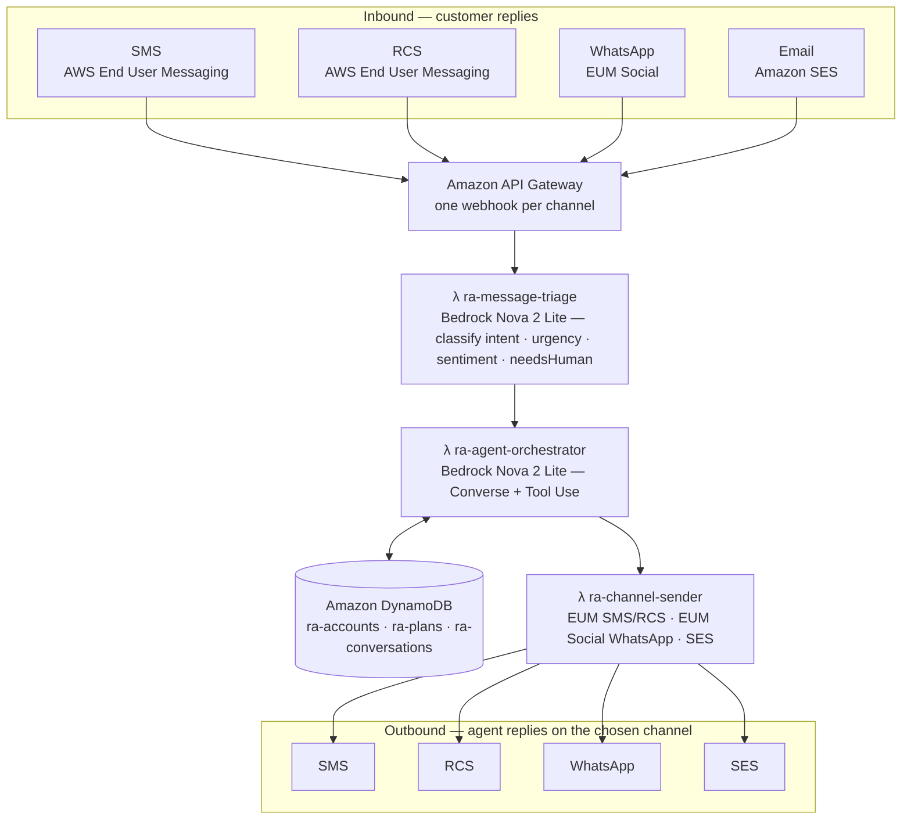
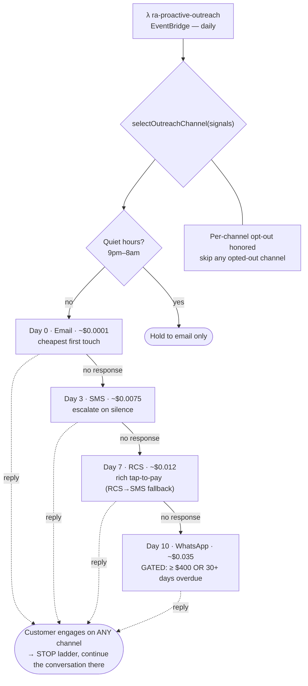
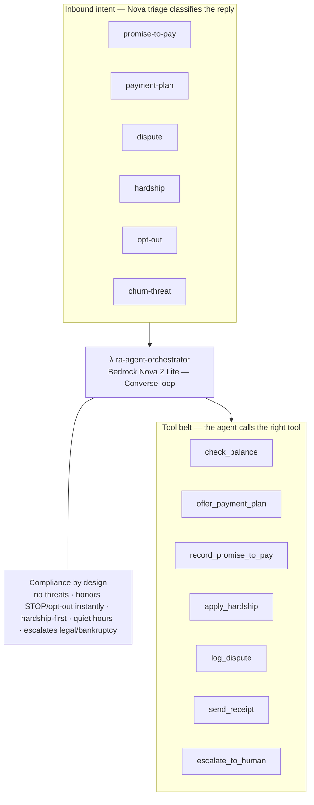
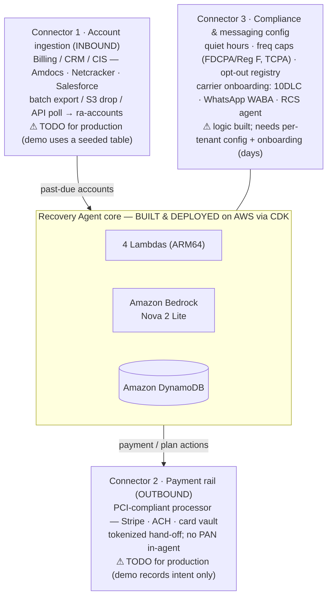

# Recovery Agent — Architecture Diagrams (Mermaid, Lucid-ready)

Paste any block below into **Lucidchart → Insert → Mermaid**, click Insert, then
restyle with the **AWS Architecture 2021** shape library and export each page via
**File → Download As → PNG** (2× / high-res) into `docs/` with the matching filename.

> Import gotchas: if a block fails, replace ` ` with a space and `([text])`
> with `[text]`; dotted "reply" edges may import solid — restyle them dashed.

---

## Page 1 — Runtime pipeline  → `architecture-runtime.png`

---

## Page 2 — Escalation-ladder decision flow  → `architecture-decision-flow.png`

---

## Page 3 — The agent (reasoning + tool belt)  → `architecture-agent-tools.png`

---

## Page 4 — Enterprise integration (the 3 connectors)  → `architecture-integration.png`

---

## Styling once in Lucid
- Swap plain shapes for **AWS Architecture 2021** icons (API Gateway, Lambda, DynamoDB, Bedrock, SES, End User Messaging).
- Color language: SMS amber · RCS blue · WhatsApp green · SES/email teal · Bedrock magenta · DynamoDB cyan · connectors orange.
- Page 4: `CORE` subgroup green ("BUILT & DEPLOYED"), the 3 connectors amber ("INTEGRATION WORK").
